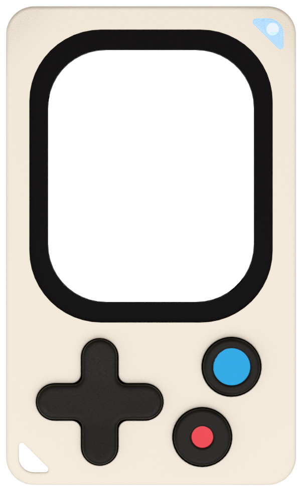
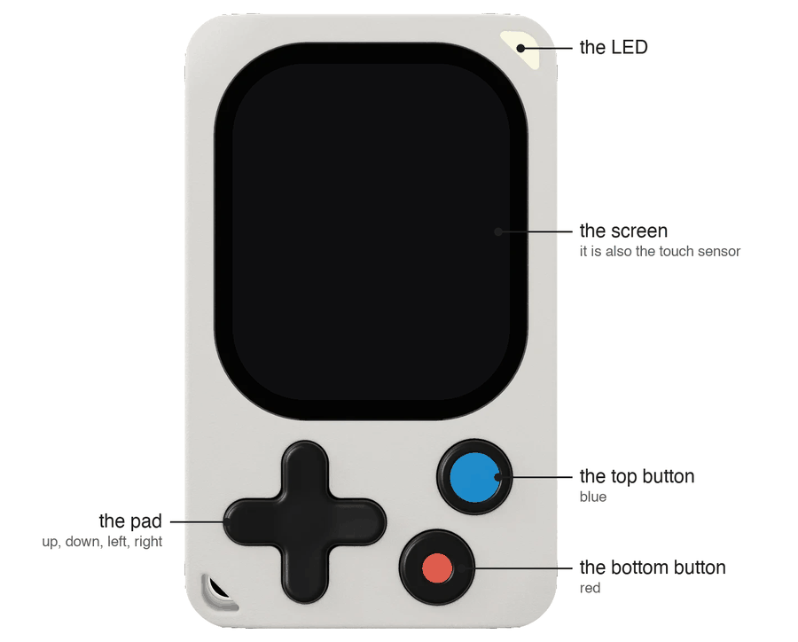

<div align="center" markdown="1">



# kodeOS

**The operating system of the Kode Dot**

[](https://github.com/espressif/esp-idf)


[](LICENSE)

[What is kodeOS](https://docs.kode.diy/internals/overview) ·
[Write an app](https://docs.kode.diy/build/setup) ·
[How the firmware is built](https://docs.kode.diy/sdk/overview) ·
[The SDK](https://github.com/kodediy/kode-sdk/blob/main/README.md)

</div>

---

The Kode Dot is a small programmable device for makers, pentesters and geeks. It has a touch screen, six buttons, a battery and several radios. Its main chip is the ESP32-P4. kodeOS is the main program that runs in the Kode Dot. It draws the screens, controls every part of the board, answers commands from a computer, manages the chips' updates (OTAs), and installs and starts user apps.

There are three ways to interact with the Kode Dot:

- **The screen**: a lock screen, a list of apps and a settings screen.
- **The console**: text commands from a computer, over serial, Bluetooth or MQTT with Kode ecosystem services.
- **The flash**: a computer writes an app into the mailbox, a fixed place in the flash, with one `esptool` command. kodeOS installs the app the next time the board starts.

## Apps

An app is a **whole firmware**: a complete program of its own. kodeOS does not load an app into itself. kodeOS and an app are separate programs, and only one of them runs at a time.

kodeOS keeps each installed app in the apps region of the flash. To start an app, kodeOS writes a boot request in that region and resets the board, and the bootloader starts the app. After the next reset of any kind, the board starts kodeOS again. An app that a computer left in the mailbox is the exception: the bootloader starts it again after the resets its own host causes. [The boot model](https://docs.kode.diy/internals/boot-model) gives the rules.

## How kodeOS is built

kodeOS is built from the SDK, the code in the folder `sdk/`, the same way an app is. The SDK is made of Active Objects from QP/C: each part of the board has exactly one Active Object that owns it, and all other code asks that owner with an event. [The SDK section](https://docs.kode.diy/sdk/overview) explains every layer and every file.

## The hardware



The Kode Dot has these parts:

- An ESP32-P4 processor with two RISC-V cores at 400 MHz.
- 32 MB of flash and 32 MB of PSRAM.
- A 410x502 AMOLED screen with touch, and six buttons.
- An RGB LED, a microSD slot, a microphone, a speaker and a vibration motor.
- A motion sensor, NFC, 125 kHz RFID and infrared.
- An ESP32-C5, a second processor that holds the Wi-Fi and Bluetooth radios.
- A charger chip that can disconnect the battery completely. With no USB cable connected, this switches the board off.

[The chip drivers](https://docs.kode.diy/sdk/kdrv/overview) describe every part, down to its registers.

## Build and flash

You build kodeOS for the ESP32-P4 with ESP-IDF v6.1. You also need `git` to download the code.

```bash
git clone --recursive https://github.com/kodediy/KodeOS.git
cd KodeOS
. $HOME/esp/esp-idf/export.sh
idf.py build
idf.py -p PORT flash
```

- `git clone --recursive` downloads the code and the SDK, a submodule. If the folder `sdk/` is empty, run `git submodule update --init --recursive`.
- The line that starts with `.` loads ESP-IDF in the terminal. Use the path where you installed ESP-IDF.
- `PORT` is the USB-C serial port of the board, for example `/dev/cu.usbmodem101` on macOS, `/dev/ttyACM0` on Linux or `COM5` on Windows.

[Building and flashing](https://docs.kode.diy/internals/building-and-flashing) explains each step.

## Layout

| Folder | What it holds |
|---|---|
| `main/` | `app_main()`: it calls `kode_init()` and then `kgui_start()` |
| `sdk/` | the SDK, a git submodule: the code that kodeOS and apps are built from |
| `components/kgui/` | the screens of kodeOS, written with the SDK |
| `bootloader_components/` | the addition that lets the bootloader start an app |
| `tools/` | the programs that talk to the board, the release scripts and the checks |
| `storage_image/` | files to copy into the `storage` partition of a board that you test by hand |

## Documentation

The documentation is at [docs.kode.diy](https://docs.kode.diy): the [SDK section](https://docs.kode.diy/sdk/overview) explains how the firmware is built, layer by layer, and the [kodeOS section](https://docs.kode.diy/internals/overview) explains the system, the console and the tools. Each component has a short README that links its page.

## Licence

kodeOS is free software. Its licence is the GNU General Public License, version 3 or later. The file [LICENSE](LICENSE) holds the full text.

The SDK holds code of other owners, and one part of it is not under that licence. [NOTICE.md](NOTICE.md) says which licence applies to each part.
